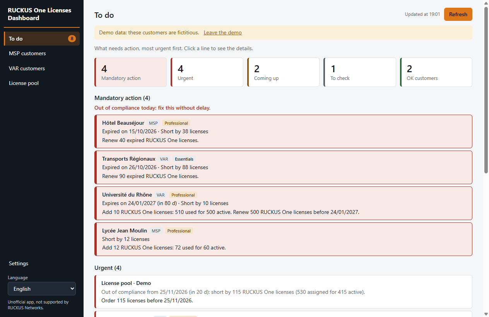
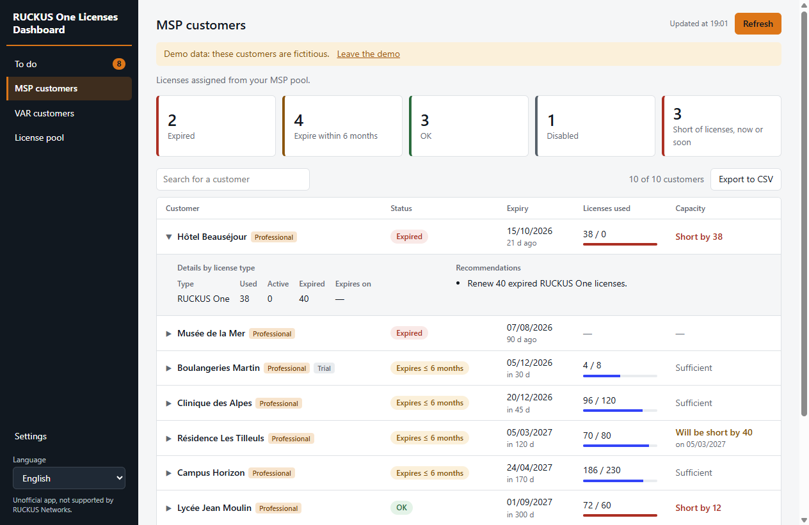
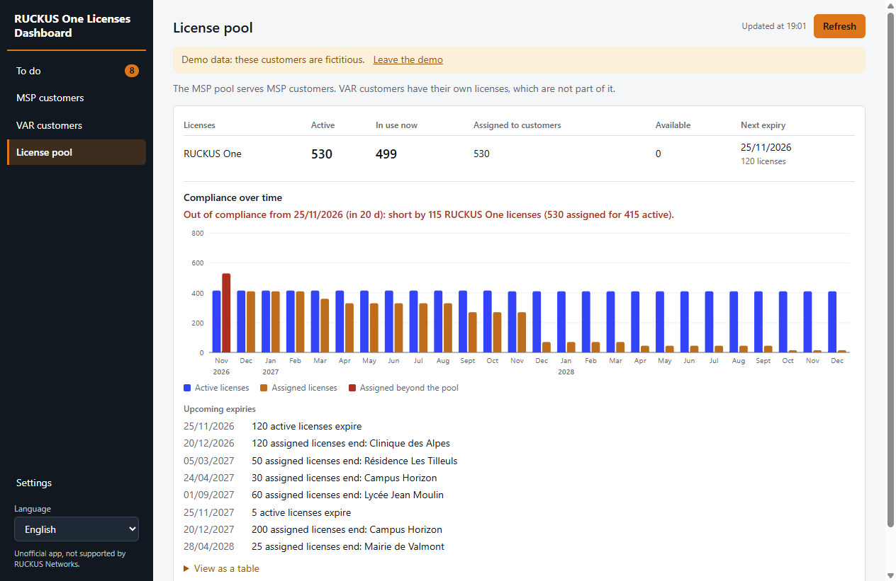

# RUCKUS One Licenses Dashboard

> **RUCKUS One Licenses Dashboard is not an official RUCKUS application. RUCKUS Networks does not provide support for it.**

A desktop app for Windows and Mac that gives back-office teams the RUCKUS One license status of every customer, without access to the console. It only reads data and changes nothing in RUCKUS One.

It tells you who needs what, and when.



| Customers | License pool |
| --- | --- |
|  |  |

## What it shows

- **To do:** what needs action, from most to least urgent, with the action to take.
- **MSP customers:** licenses assigned from your MSP pool.
- **VAR customers:** end-user (REC) licenses tied to each customer, outside the MSP pool.
- **License pool:** active, used, assigned and available licenses, the compliance forecast over time, and upcoming expiries.

Customer statuses use one color code:

| Color | Meaning |
| --- | --- |
| Red | Expired |
| Orange | Expires within 6 months |
| Green | OK |
| Gray | Tenant disabled, or no license information returned by RUCKUS One |

The **To do** page sorts actions into four groups:

| Group | When |
| --- | --- |
| **Mandatory action** | Out of compliance today: licenses are required but missing, or the license pool is already short |
| **Urgent** | Tenant expires within 60 days, licenses will run short within 60 days, the license pool will run short within 6 months, or a Professional customer is covered only by Essentials licenses |
| **Coming up** | Expiry or shortage further ahead |
| **To check** | Tenant expired with no device attached: ask a technician whether it can be deleted |

Available in English (default), German, Spanish, French, Italian, Dutch, Polish, Portuguese, Japanese and Simplified Chinese. The texts are in `src/shared/i18n.js`.

## Download and test

Download the installers from the [Releases page](../../releases), and follow the [testing guide](TESTING.md).

The installers are not signed, so Windows SmartScreen and macOS Gatekeeper show a warning. The guide explains how to get past it. The Mac version has not been tested on a Mac yet.

## Updates

When the app starts, it asks GitHub for the list of published versions. It sends nothing about your accounts or customers. If a newer version exists, a banner appears at the top: **Download** opens the right file for your computer in the browser, and you then install it yourself. Your accounts and settings are kept. If the check fails, for example when offline, the app shows nothing.

The app does not install updates by itself, because the installers are not signed. The banner first appears from the version after v0.1.0, so anyone on v0.1.0 has to download the next version by hand once.

## Create the access token

In RUCKUS One, go to **Administration > Account Management > Settings > Application Token**. The **Read-Only** scope is enough.

The app needs four values: the **region**, the **Tenant ID**, the **Client ID** and the **shared secret**. Add one account per RUCKUS One account, for example one MSP and one VAR.

The secret is encrypted by the operating system (DPAPI on Windows, Keychain on Mac) and stored in the user's profile. It is only sent to the RUCKUS authentication server of the chosen region.

## Development

```bash
npm install
```

```bash
npm start
```

```bash
npm test
```

With no account configured, **View the demo** shows fictitious customers. The demo runs the same code as the real mode, against a fake server (`src/core/demoServer.js`).

To regenerate the documentation screenshots from the demo:

```bash
npx electron scripts/doc-screenshots.js
```

## Build the installers

```bash
npm run dist:win
```

```bash
npm run dist:mac
```

The Mac package has to be built on a Mac. GitHub Actions builds both on every push to `main`, and pushing a `vX.Y.Z` tag publishes a pre-release with the installers.

## RUCKUS One APIs used

Reference: <https://docs.ruckus.cloud/api>

| Purpose | Call |
| --- | --- |
| Authentication | `POST https://{region.}ruckus.cloud/oauth2/token/{tenantId}` |
| MSP customers and their licenses | `POST /tenants/query` |
| VAR customers | `POST /delegations/query?inclEntitlements=true` |
| Tier of a VAR customer | `GET /tenants/self` with the `x-rks-tenantid` header |
| Licenses of a VAR customer | `POST /entitlements/query` with `x-rks-tenantid` |
| Licenses used by a VAR customer | `POST /entitlements/compliances/query` with `x-rks-tenantid` |
| Account license pool and usage | `POST /entitlements/compliances/query` |
| Account license details | `POST /entitlements/query` |

Findings from a real MSP account, where the behavior differs from or goes beyond the published specification:

- `/entitlements/compliances/query` returns its data in `data`, with `activeLicenses`, `licensesUsed` and `licensesAvailable`.
- `accountTier` gives the customer tier: `Platinum` is Professional, `Gold` is Essentials. `displayTier` is empty for most customers.
- `futureOutOfComplianceDevices` is set for any customer with devices, at the end date of its license, so it does not by itself mean a shortage.

## Known limits

- Dates are shown in UTC, so they can be one day earlier than in the console.
- A customer shows as expired once the date has passed, even during the grace period. The API returns `graceEndDate` and `serviceMode`, which are not used yet.
- Paid Essentials licenses and an account with only VAR or end-customer access have not been tested on real data yet.
- The translations have not been reviewed by native speakers.

The **Diagnostics** button in **Settings** creates an anonymized file with the API responses, to help analyze a real account. It contains no secret or token, and it replaces names, addresses and IDs with aliases.
