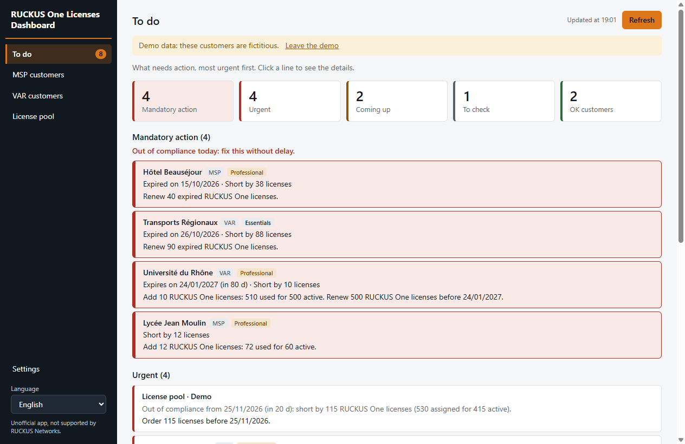
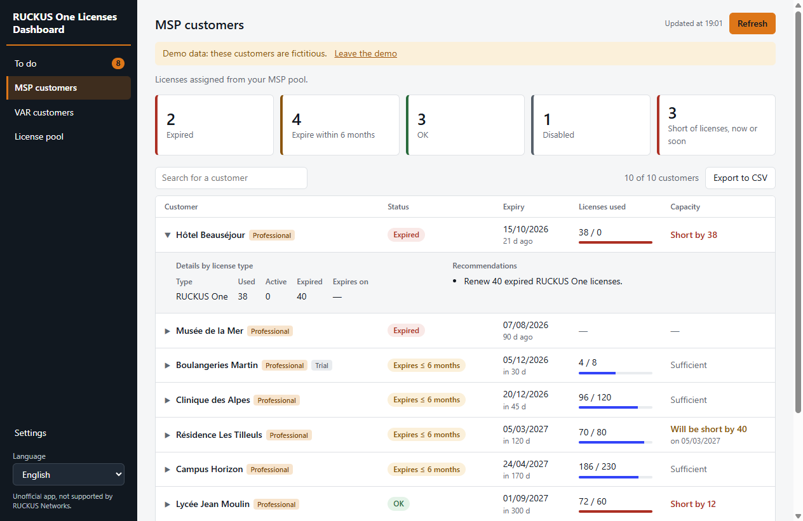
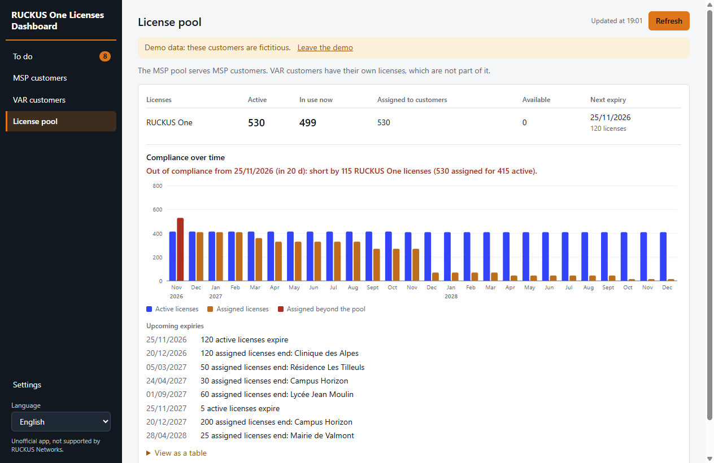
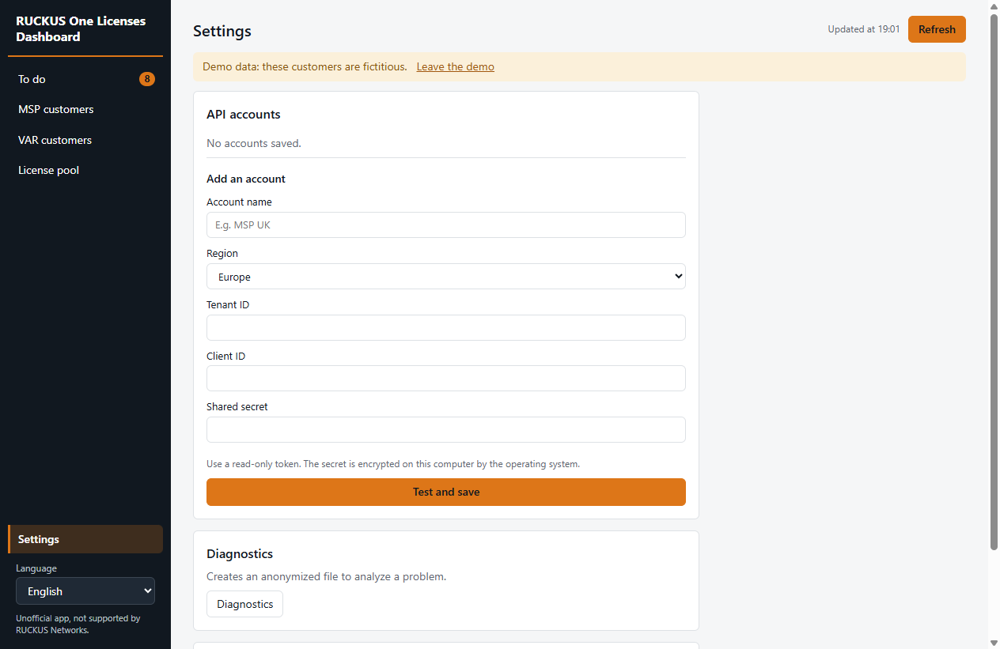
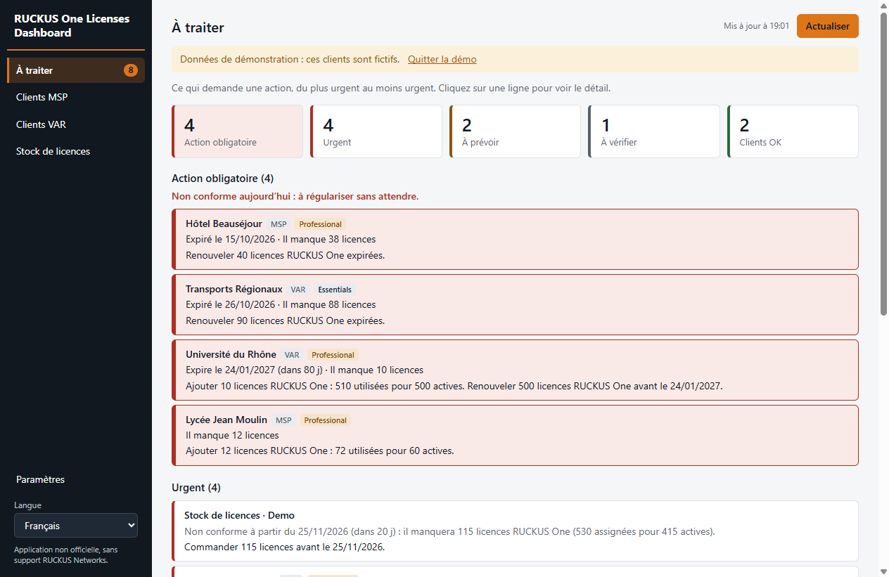
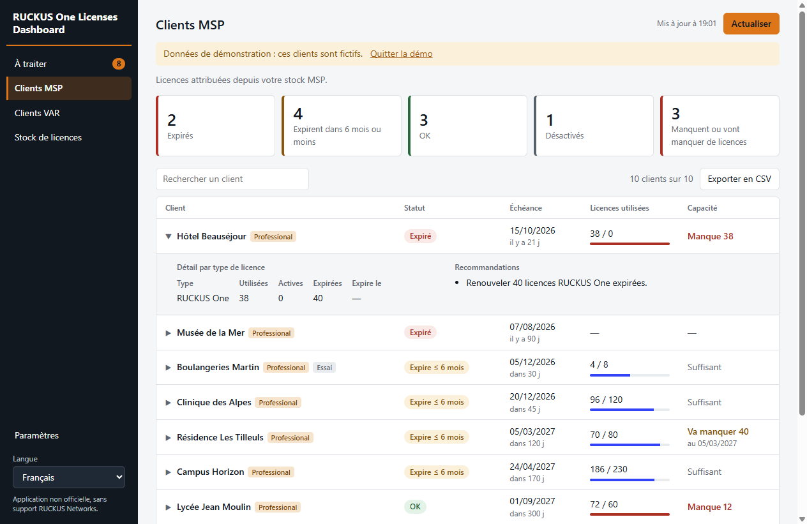
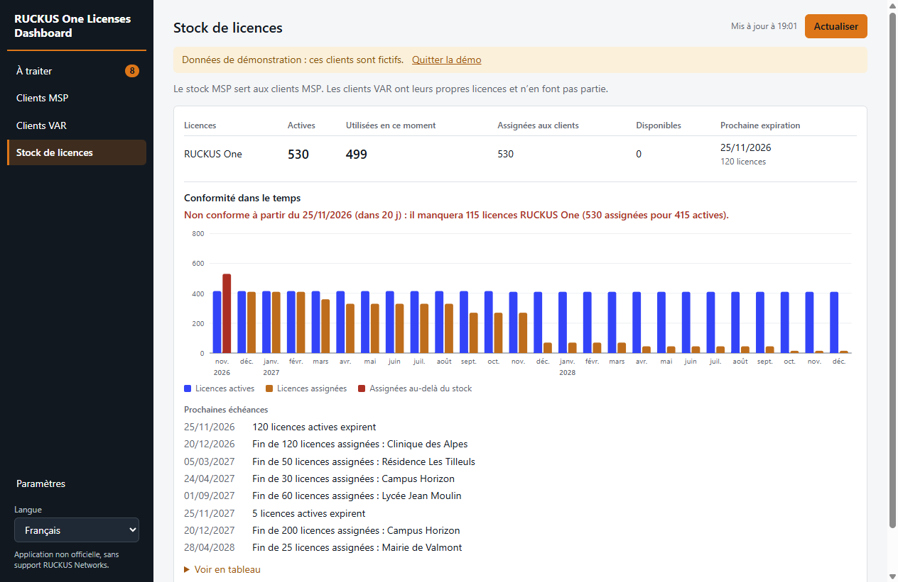
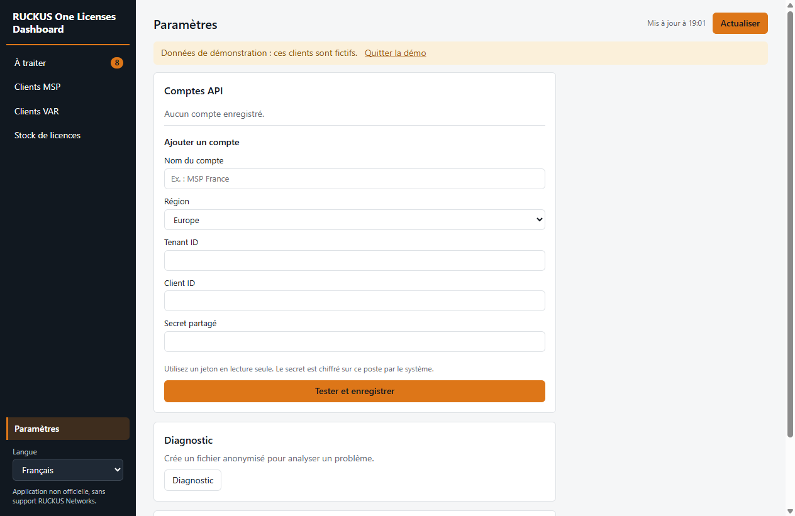

# Testing RUCKUS One Licenses Dashboard

*Version française plus bas.*

> **RUCKUS One Licenses Dashboard is not an official RUCKUS application. RUCKUS Networks does not provide support for it.** Do not contact RUCKUS support about it: report problems in this repository.

RUCKUS One Licenses Dashboard shows RUCKUS One license status per customer for back-office teams. It only reads data and changes nothing in RUCKUS One. This is a test version.

## Install

Download the file for your computer from the assets of this release:

| Computer | File |
| --- | --- |
| Windows, no installation | `RUCKUS-One-Licenses-Dashboard-…-portable.exe` |
| Windows, installer | `RUCKUS-One-Licenses-Dashboard-Setup-….exe` |
| Mac with Apple chip (M1 and later) | `RUCKUS-One-Licenses-Dashboard-…-arm64.dmg` |
| Mac with Intel chip | `RUCKUS-One-Licenses-Dashboard-…-x64.dmg` |

The app is not signed yet, so your computer will warn you:

- **Windows:** on "Windows protected your PC", choose **More info**, then **Run anyway**.
- **Mac:** drag the app to Applications. If macOS blocks it or says it is damaged, run this in Terminal, then open it again:

```bash
xattr -cr "/Applications/RUCKUS One Licenses Dashboard.app"
```

## Try it

**Without a RUCKUS account:** click **View the demo**. All customers shown are fictitious.

**With your account:** in **Settings**, add the region, Tenant ID, Client ID and shared secret. Create the application token in RUCKUS One under Administration, Account Management, Settings, with the Read-Only scope, which is enough. The secret is encrypted on your computer. Never share it in an issue or a message.

## What you will see

**To do** lists what needs action, most urgent first. Click a line to open the customer.



**MSP customers** and **VAR customers** show each customer's status, expiry and licenses. Click a customer for the details and recommendations. VAR customers have their own licenses, outside the MSP pool.



**License pool** shows active, used, assigned and available licenses, how they change over time, and upcoming expiries.



**Settings** holds the API accounts and the diagnostic.



## What to check

1. **To do:** is it clear what you have to do, and are the priorities right?
2. **MSP customers and VAR customers:** do statuses, dates and license counts match the RUCKUS One console? Dates are in UTC, so they can be one day earlier than the console.
3. **License pool:** do the figures and the chart match the console's Device Networking Paid Licenses chart?
4. **Wording:** is anything too technical for a back-office colleague? Is the translation in your language correct?

## Report a problem

Open an issue in this repository with what you expected and what you saw. **This repository is public: never write customer names, tenant IDs, tokens or secrets in an issue.** If the figures are wrong, a diagnostic file helps: **Settings**, **Diagnostics**.

The diagnostic contains no secret or token, and it replaces customer names, addresses and IDs with aliases. It does keep dates, quantities, statuses and license SKUs. Read it before sharing it, and only post it if you are comfortable with it being public.

---

# Tester RUCKUS One Licenses Dashboard

> **RUCKUS One Licenses Dashboard n'est pas une application officielle RUCKUS. La société RUCKUS Networks n'en assure pas le support.** Ne contactez pas le support RUCKUS à son sujet : signalez les problèmes dans ce dépôt.

RUCKUS One Licenses Dashboard affiche le statut des licences RUCKUS One par client, pour les équipes de back-office. L'application lit les données et ne modifie rien dans RUCKUS One. C'est une version de test.

## Installer

Téléchargez le fichier adapté à votre poste dans les fichiers de cette version :

| Poste | Fichier |
| --- | --- |
| Windows, sans installation | `RUCKUS-One-Licenses-Dashboard-…-portable.exe` |
| Windows, avec installation | `RUCKUS-One-Licenses-Dashboard-Setup-….exe` |
| Mac avec puce Apple (M1 et suivantes) | `RUCKUS-One-Licenses-Dashboard-…-arm64.dmg` |
| Mac avec puce Intel | `RUCKUS-One-Licenses-Dashboard-…-x64.dmg` |

L'application n'est pas encore signée, votre poste affichera donc un avertissement :

- **Windows :** sur « Windows a protégé votre ordinateur », choisissez **Informations complémentaires**, puis **Exécuter quand même**.
- **Mac :** glissez l'application dans Applications. Si macOS la bloque ou la dit endommagée, lancez la commande de la partie anglaise dans le Terminal, puis rouvrez-la.

## Essayer

**Sans compte RUCKUS :** cliquez sur **Voir la démo**. Tous les clients affichés sont fictifs.

**Avec votre compte :** dans **Paramètres**, ajoutez la région, le Tenant ID, le Client ID et le secret partagé. Créez le jeton d'application dans RUCKUS One sous Administration, Account Management, Settings, avec les droits Read-Only, qui suffisent. Le secret est chiffré sur votre poste. Ne le partagez jamais dans un ticket ou un message.

L'application démarre en anglais : la langue se change en bas du menu.

## Ce que vous allez voir

**À traiter** liste ce qui demande une action, du plus urgent au moins urgent. Cliquez sur une ligne pour ouvrir le client.



**Clients MSP** et **Clients VAR** montrent le statut, l'échéance et les licences de chaque client. Cliquez sur un client pour voir le détail et les recommandations. Les clients VAR ont leurs propres licences, hors stock MSP.



**Stock de licences** montre les licences actives, utilisées, assignées et disponibles, leur évolution dans le temps et les prochaines échéances.



**Paramètres** regroupe les comptes API et le diagnostic.



## Ce qu'il faut regarder

1. **À traiter :** comprend-on ce qu'il faut faire, et les priorités sont-elles justes ?
2. **Clients MSP et Clients VAR :** les statuts, dates et nombres de licences correspondent-ils à la console RUCKUS One ? Les dates sont en UTC et peuvent donc avoir un jour de moins que la console.
3. **Stock de licences :** les chiffres et le graphique correspondent-ils au graphique Device Networking Paid Licenses de la console ?
4. **Vocabulaire :** quelque chose est-il trop technique pour le back-office ? La traduction dans votre langue est-elle correcte ?

## Signaler un problème

Ouvrez un ticket (issue) dans ce dépôt en indiquant ce que vous attendiez et ce que vous avez vu. **Ce dépôt est public : n'écrivez jamais de nom de client, de Tenant ID, de jeton ou de secret dans un ticket.** Si les chiffres sont faux, un fichier de diagnostic aide : **Paramètres**, **Diagnostic**.

Le diagnostic ne contient ni secret ni jeton, et remplace les noms de clients, les adresses et les identifiants par des pseudonymes. Il conserve les dates, quantités, statuts et SKU de licence. Relisez-le avant de le partager, et ne le publiez que si vous acceptez qu'il soit public.
